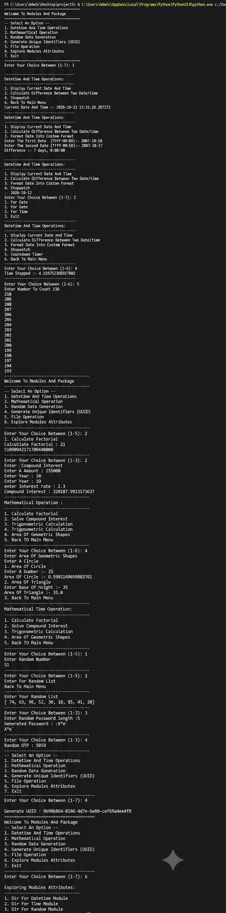

# Moduler-Packager

A menu-driven Python application that brings together useful utilities in separate modules and a package.

## Features

### 1. Date and Time Operations
- Display the current date and time
- Calculate the difference between two dates
- Format date and time
- Use a stopwatch and countdown timer

### 2. Mathematical Operations
- Perform mathematical calculations
- Calculate compound interest
- Calculate trigonometric values such as sine and cosine
- Calculate the area of a circle, rectangle, and square

### 3. Random Data Generation
- Generate random numbers and lists
- Create random passwords
- Generate random OTPs

### 4. UUID Generation
- Generate unique identifiers (UUIDs)

### 5. File Operations
- Perform file-related operations through a custom module

### 6. Module Exploration
- Explore module attributes using Python's `dir()` function

## Output Screenshots

To display screenshots of the application on GitHub, save your screenshots in an `output.png` folder in the project root and add the appropriate image paths below.




## Technologies Used

- Python
- Python Standard Library
- Visual Studio Code (development environment)
- Git
-Github 

## Concepts Used

- Functions
- Conditional statements (`if`, `elif`, `else`)
- Loops (`for`, `while`)
- User input and output
- Modules and packages
- Importing libraries
- Exception handling (where implemented)
- Date and time handling
- Random number generation
- File handling
- String formatting and mathematical formulas

## How to Use

1. Run the program from the terminal.
2. Choose an option from the main menu.
3. Follow the prompts and enter the requested values.
4. Read the result displayed in the terminal.
5. Return to the main menu or choose the exit option when finished.

## Installation and Setup

1. Install a version of Python compatible with the source code.
2. Download or clone this project to your computer.
3. Open the project folder in Visual Studio Code or a terminal.
4. Make sure the terminal is in the project root directory.
5. Run the application:

   ```bash
   python main.py
   ```

   If your system uses the Python launcher on Windows, you can run:

   ```bash
   py main.py
   ```

The project uses Python's standard library, provided no third-party dependencies have been added.

## Example Output

The exact menu wording may differ depending on the implementation.

### Main Menu

```text
Welcome to Multi-Utility Toolkit

Choose an option:
1. Date-Time and Time Operation
2. Mathematical Operation
3. Random Data Generation
4. Generate Unique Identifiers (UUID)
5. File Operation (Custom Module)
6. Explore Module Attributes (dir())
7. Exit

Enter Your Choice :- 2
```

### Example: Area of a Circle

```text
Select an Option:
1. Area of Circle
2. Area of Rectangle
3. Area of Square
4. Back to Main Menu

Enter Choice:- 1
Enter radius: 30
Area of Circle = 2827.43
```

## Project Structure

```text
Moduler-Packager/
├── package/
│   ├── __init__.py
│   ├── explore_utils_module.py
│   ├── file_utils_modules.py
│   └── math_utils_module.py
├── main.py
├── output.png
└── README.md
```

## Author

Bhavya Sahetiya
